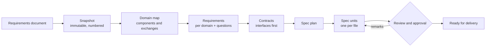

# SDD pipeline: from requirements to specs with AI agents

[Русская версия](README.ru.md)

A spec-driven development (SDD) pipeline that takes a structured requirements document (business requirements, functional specification, PRD) and produces a set of small, traceable, reviewable specifications: one API method, one data model, one screen, one integration per file.

AI agents write the drafts. People decide and approve. A deterministic checker keeps the form and traceability honest.



## What it is

- **A method.** Ten principles with reasons: why the input is never edited, why requirements are split by components instead of document sections, why interfaces are listed before planning, why "I don't know" must be a tracked question. See [docs/concepts.md](docs/concepts.md).
- **An agent kit.** `AGENTS.md`, ten skills (one per step), two subagents, templates and a complete example. Works with Claude Code, Codex, Kilo Code, OpenCode, and with any agent that can read `AGENTS.md`.
- **Tools.** Three Python scripts that need only the standard library: `snapshot.py` (numbered snapshot of the input), `slices.py` (per-domain extracts of it), `check.py` (form, links, coverage, gates, traceability). Covered by regression tests.

What it is not: a converter from Word or wiki pages (bring Markdown, made by any tool you like), a project management system, or a code generator. It stops at approved specs; tasks, code and tests are built from them by your own process.

## Quick start

1. Copy this repository (or use it as a template) and open it in your agent tool.
2. Convert your requirements document to Markdown and put it into `features/<ID>-<slug>/source/import/`.
3. Run the skills in order, a fresh agent session per run:

| Step | Skill | Result |
|---|---|---|
| 1 | `sdd-intake` | snapshot `source/source.md`, passport `README.md` |
| 2 | `sdd-map` | domain map `analysis.md`, slices `source/domains/` |
| 3 | `sdd-domain` (per domain) | `requirements/<domain>.md`, questions |
| 4 | `sdd-impact` (optional) | impact on an existing system |
| 5 | `sdd-contracts` | `contracts/README.md`, cards `CON-NNN` |
| 6 | `sdd-plan` | spec plan in the passport |
| 7 | `sdd-spec` (per unit) | `specs/SPEC-NN-*.md` |
| 8 | `sdd-review` (per unit) | remarks and a verdict |
| any time | `sdd-decide`, `sdd-update` | answers applied, new input version handled |

4. Check at any point:

```bash
python tools/check.py features/<ID>-<slug>
```

Look at [examples/LIB-1-book-reservations](examples/LIB-1-book-reservations/README.md) first: a fictional library feature taken through every step, with open questions and unwritten specs left on purpose.

## Repository layout

| Path | What is there |
|---|---|
| `AGENTS.md` | rules the agent always reads |
| `.agents/skills/` | pipeline skills `sdd-*` (source of truth) |
| `.agents/subagents/` | instructions of `sdd-check` and `sdd-source` |
| `.claude/`, `.kilo/`, `.opencode/` | adapters for specific tools |
| `templates/` | templates of every artifact |
| `examples/` | the complete example feature |
| `features/` | your features |
| `tools/` | scripts and their tests |
| `sdd.config.json` | project settings: language, scope labels, unit types, house rules |
| `docs/` | documentation |

Skills, templates and agent rules are in English: the model reads them. Human documentation is in English and Russian. The language agents use for the artifacts themselves is set in `sdd.config.json` (`artifact_language`).

## Documentation

| Document | For whom |
|---|---|
| [docs/concepts.md](docs/concepts.md) | everyone: the principles and why they exist |
| [docs/pipeline.md](docs/pipeline.md) | analysts and leads: stages, gates, changes along the way |
| [docs/artifacts.md](docs/artifacts.md) | everyone who writes or reviews: files, IDs, statuses, formats |
| [docs/agents.md](docs/agents.md) | whoever runs the agent: setup per tool, skills, failure modes |
| [docs/customization.md](docs/customization.md) | adopting the pipeline in a team: settings, unit types, house rules |

## Requirements

Python 3.8+ (standard library only), git, an agent tool. Tested on Windows and Linux.

## License

[MIT](LICENSE).
