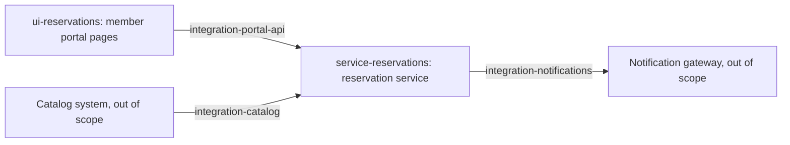

# Analysis LIB-1

## Summary

Members get online reservations: a "Reserve" button on the title page and a "My reservations" page. A new reservation service owns the rules and the data; it checks availability in the catalog system and asks the notification gateway to email the member. Both of those systems are out of scope. The map has 5 domains: 2 nodes and 3 edges.

## How to read the map

- Node - a component or a large part of one, with its own data and logic. Edge - an exchange between components; edges grow into contracts. Scenario - a chain through several domains, not a domain.
- Domain name = requirements file name `requirements/<domain>.md`. UI nodes start with `ui-`.
- One home per requirement: behaviour inside a component - its node; data and order of an exchange - the edge; the screen shows, the service decides.

## Solution map

## Domains

| Domain | Kind | Component | Summary | Questions |
|---|---|---|---|---|
| service-reservations | node | Reservation service (new) | reservation rules, lifetime, audit, storage | Q-002, Q-005 |
| ui-reservations | node | Member portal | "Reserve" button on the title page, "My reservations" page | - |
| integration-catalog | edge | Catalog system -> Reservation service | availability of a title at a branch | Q-006 |
| integration-portal-api | edge | Reservation service -> Member portal | create, list and cancel reservations | - |
| integration-notifications | edge | Notification gateway -> Reservation service | reservation emails and the expiry reminder | Q-001 |

## Source slices

### service-reservations - reservation rules and data

Node, the new reservation service. Inside: limits, lifetime, cancellation, retention, audit, performance. Not here: how the catalog is asked (integration-catalog), what the screens show (ui-reservations).

Links: provides integration-portal-api; consumes integration-catalog; provides requests to integration-notifications.

Read:

- 3, 4 - who may act and on whose reservations; what is out of scope.
- 5 - all reservation rules.
- 8 - performance and audit.
- 9 - what is postponed.

Watch: "visible for 30 days" does not say from when and does not mention cancelled reservations.

### ui-reservations - member portal pages

Node, member portal. Inside: the button, messages, the table, sorting, empty state. Not here: the rules behind them (service-reservations).

Links: consumes integration-portal-api.

Read:

- 5.3 - the message when the catalog is unreachable.
- 6 - both screens.

Watch: the title page "already lists branches with available copies" - where that list comes from today.

### integration-catalog - availability check

Edge, catalog system -> reservation service. Inside: what we ask and what we need back, what happens when the catalog is down.

Links: provider - catalog system (out of scope), consumer - service-reservations.

Read:

- 3 - the catalog is used as it is.
- 5.3 - availability rule and the failure message.

Watch: the catalog interface is not described in the input.

### integration-portal-api - portal to reservation service

Edge, member portal -> reservation service. Inside: operations the pages need.

Links: provider - service-reservations, consumer - ui-reservations.

Read:

- 4 - identity of the member.
- 6 - operations behind the screens.

### integration-notifications - emails to members

Edge, reservation service -> notification gateway. Inside: the "reservation made" email and the reminder.

Links: provider - notification gateway (out of scope), consumer - service-reservations.

Read:

- 3 - the gateway is used as it is.
- 7 - both notifications.

Watch: the reminder has no timing.

## Scenarios

| Scenario | Source | Path | Plan coverage |
|---|---|---|---|
| Reserve a book | 5.1, 5.3, 6.1, 7 | ui-reservations -> integration-portal-api -> service-reservations -> integration-catalog -> integration-notifications | SPEC-09 |
| Reservation expires | 5.2, 7 | service-reservations -> integration-notifications | SPEC-05 |

## Cross-cutting rules

- A member sees and changes only their own reservations (source 4) - applies to service-reservations, integration-portal-api, ui-reservations.

## Glossary

| Term | Meaning | Synonyms in the source | In specs |
|---|---|---|---|
| Member | a logged-in user of the member portal | user, reader | Member, `member_id` |
| Title | a book as a catalog entry, not a physical copy | book | Title, `title_id` |
| Copy | a physical item of a title at a branch | - | only as the availability count |
| Branch | a library location where the book is picked up | - | Branch, `branch_id` |
| Reservation | a title held for a member at a branch for 3 days | booking | Reservation, `reservation` |
| End of a reservation | the moment it stops being active | "valid until", "the date until which the book is held" | `valid_until` |

## Findings for domains

### integration-portal-api

- The list needs title and author, the catalog is the only source of them (source 6.2; found in ui-reservations).
- Applied 2026-11-03 in requirements/integration-portal-api.md

## Sections by domain

| Section | Domains | Notes |
|---|---|---|
| 0 Preamble | - | no requirements: document version |
| 1 Background | - | no requirements: motivation |
| 2 Goals | - | no requirements: goals; the call reduction target is a business metric |
| 3 Scope | service-reservations, integration-catalog, integration-notifications | |
| 4 Users and access | service-reservations, integration-portal-api | |
| 5 Business rules | service-reservations | |
| 5.1 Reservation limits | service-reservations | |
| 5.2 Reservation lifetime | service-reservations | |
| 5.3 Availability | service-reservations, ui-reservations, integration-catalog | |
| 6 Screens | ui-reservations, integration-portal-api | |
| 6.1 Title page: Reserve button | ui-reservations, integration-portal-api | |
| 6.2 My reservations page | ui-reservations, integration-portal-api | |
| 7 Notifications | integration-notifications | |
| 8 Non-functional requirements | service-reservations | |
| 9 Open points | service-reservations | no requirements in this iteration: librarian override is postponed |

## Impact

Not applicable: a green-field service; the member portal gets a new page and a button on an existing page.

| Component | What changes | Code or docs | Contracts |
|---|---|---|---|
| Reservation service | new component | - | CON-002, CON-003, CON-004 |
| Member portal | new page, new button on the title page | portal repository, not reviewed | CON-002, CON-003, CON-004 |

## Risks

| Risk | Impact | Response |
|---|---|---|
| Catalog interface is unknown | integration spec and the availability check | Q-006 to the Catalog team |
| Reminder timing is undefined | notification integration and the expiry job | Q-001 to the business |

## Next steps

1. Map approved (M-001).
2. Domains analysed: service-reservations, integration-catalog, integration-notifications, integration-portal-api, ui-reservations.
3. Contracts and plan done; specs in progress.
