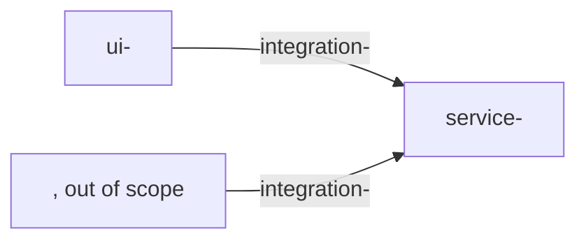

# Analysis <ID>

<!-- Two parts. 1) Domain map (sdd-map) - before requirements: how the input splits into domains.
     2) Impact (sdd-impact, optional) - after requirements: what changes in existing components.
     Headings of this file are read by tools/check.py and tools/slices.py - do not rename them. -->

## Summary

<2-4 sentences: what changes for users, which components take part, how many domains.>

## How to read the map

- Node - a component or a large part of one, with its own data and logic. Edge - an exchange between components; edges grow into contracts. Scenario - a chain through several domains, not a domain.
- Domain name = requirements file name `requirements/<domain>.md`, lowercase kebab-case. UI nodes start with `ui-`.
- One home per requirement:
  1. Behaviour inside a component - that component's domain.
  2. Data and order of an exchange - the edge.
  3. A chain through several components - a scenario; each domain keeps the requirement for its part, all parts cite the same source section.
  4. The screen shows, the service decides. What to show and which actions are allowed - the service domain; how to show it - the UI domain; which fields and operations the screen needs - the edge.
- The source text is never edited or retold. A domain's slice is its Read list below; `tools/slices.py` builds `source/domains/<domain>.md` from it.

## Solution map

<!-- Optional diagram: nodes are node domains, arrows are edge domains. Dashed - not decided yet, with a question marker. -->

## Domains

| Domain | Kind | Component | Summary | Questions |
|---|---|---|---|---|
| service-<part> | node | <component> | <what is inside> | - |
| integration-<exchange> | edge | <provider> -> <consumer> | <what is exchanged> | Q-NNN |

## Source slices

<!-- For each domain: what is inside, links, which source sections to read and what to look for.
     Read list format (strict, parsed by tools/slices.py): a line "Read:" and bullets "- <refs> - <what to look for>."
     refs: N - section with its subsections; N-M - from N to the end of M; N (intro) - only the text of N before its
     subsections; several refs separated by ", ". A part of a section (one table row) - give the section and say
     which part in "what to look for". -->

### service-<part> - 

<Node or edge, component. What is inside, what belongs to neighbouring domains.>

Links: <edges it provides or consumes>.

Read:

- <N>, <N-M>, <N> (intro) - <what to look for>.

Watch: <contradictions, different names for one thing, text only on images>.

## Scenarios

<!-- Chains through several domains. "Plan coverage" is filled by sdd-plan. -->

| Scenario | Source | Path | Plan coverage |
|---|---|---|---|
| <name> | <N, N.M> | <ui-... -> integration-... -> service-...> | <SPEC-NN> |

## Cross-cutting rules

- <rule> (source N) - applies to <domains>.

## Findings for domains

<!-- Requirements and questions found while working on one domain whose home is another, not yet analysed domain.
     The agent reads its subsection before analysing the domain and then adds "- Applied <date> in <file>". -->

### <domain>

- <finding> (source N; found in <domain>).

## Sections by domain

<!-- Every section of source/index.md: domains or "-". First cell - number and title. A section all domains
     need (constraints, overview) - "all". -->

| Section | Domains | Notes |
|---|---|---|
| 1 <title> | - | no requirements: <why> |

## Impact

<!-- Filled by sdd-impact when there is an existing system or code. Every statement about code - with a path.
     Not found - say so. Delete the section for a green-field feature. -->

| Component | What changes | Code or docs | Contracts |
|---|---|---|---|
| <component> | <new endpoint, field, table> | `<path>` | CON-NNN |

## Risks

| Risk | Impact | Response |
|---|---|---|
| <risk> | <what it affects> | <measure or Q-NNN> |

## Next steps

1. Slices built; the owner approves the map (record M-NNN in decisions/manual.md).
2. Analyse domains one per run (sdd-domain). Order: <domains>.
3. Impact (sdd-impact), if there is an existing system.
4. Send the questions.
